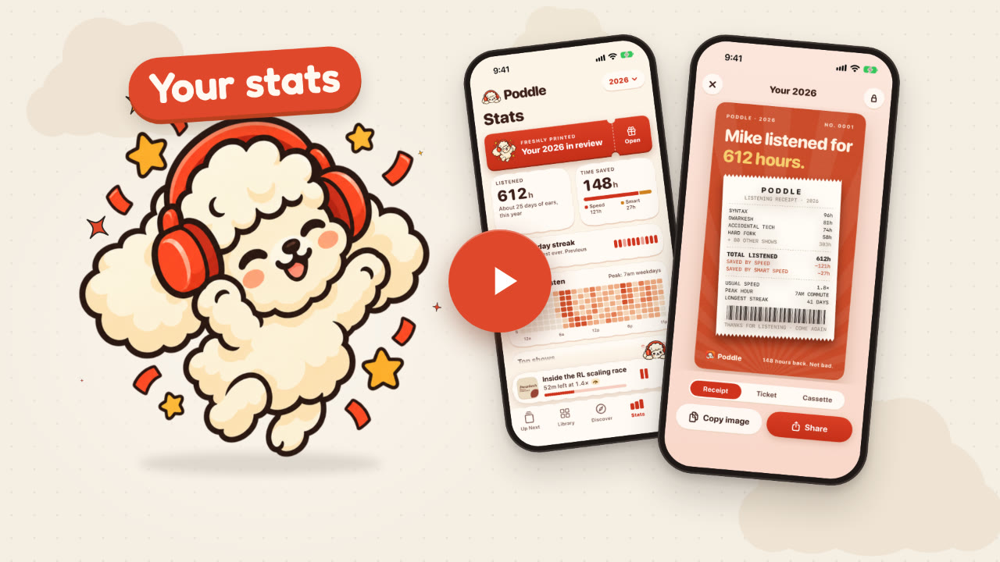
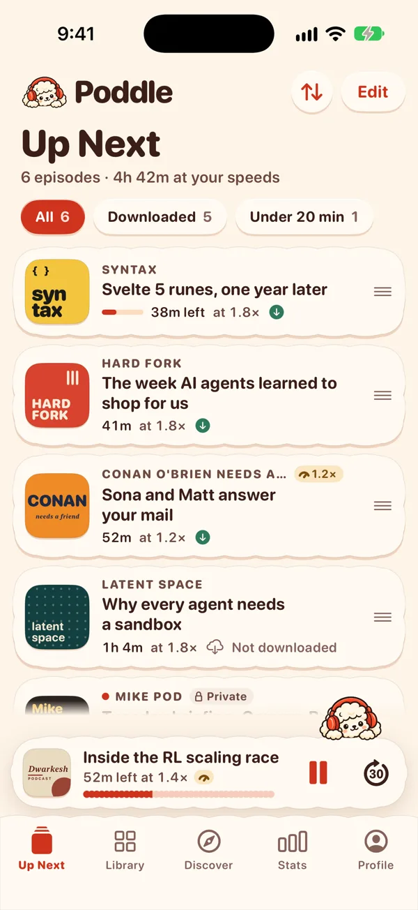
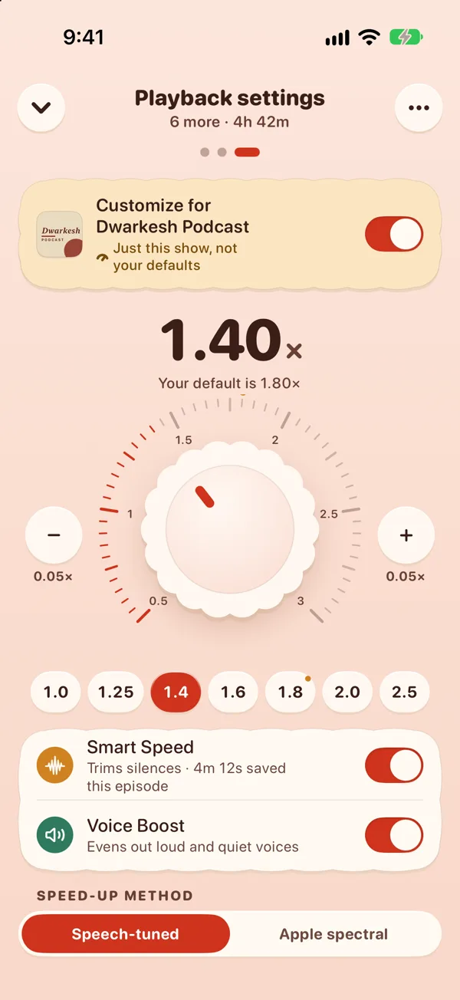
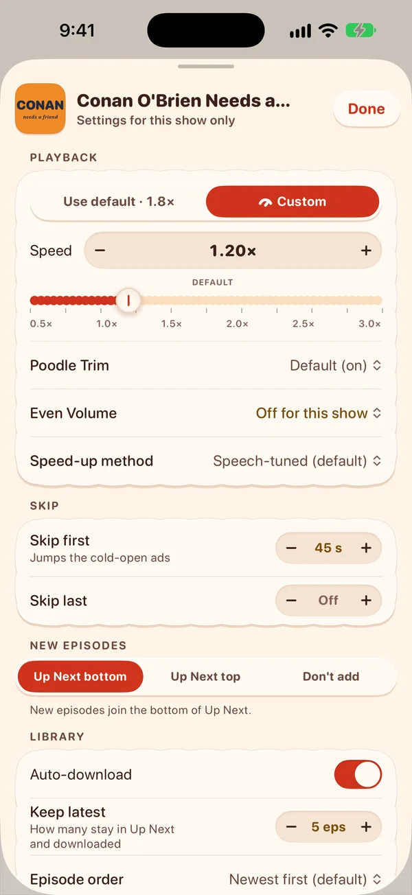
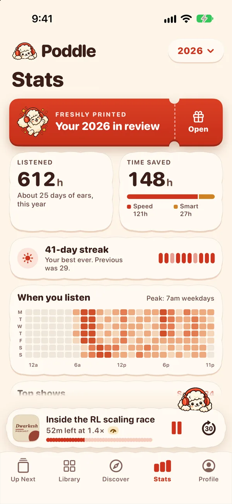
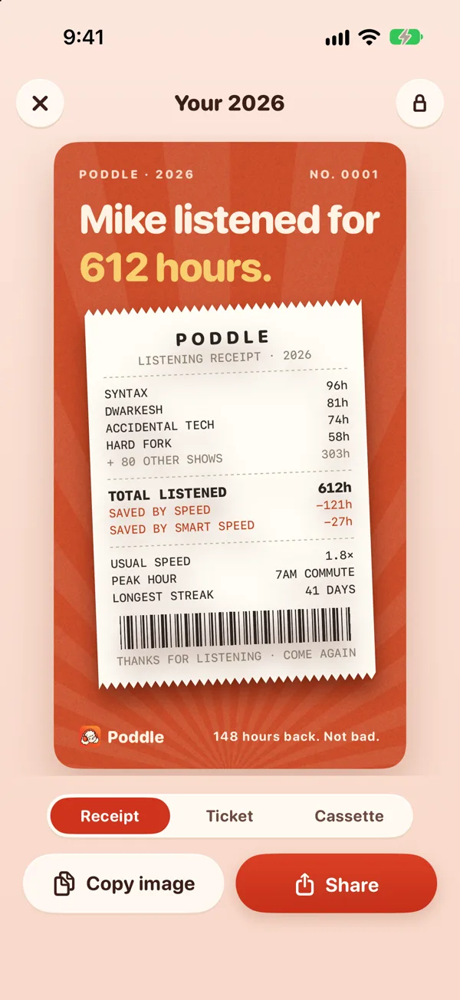

# Poddle

<p align="center">
  <a href="https://youtu.be/cs5NGfffivc"></a>
</p>

Poddle is a podcast player I made for myself. I listen to a lot of podcasts and wanted a player that looks, works and feels exactly the way I want it to. It's got one Up Next queue, speed-ups that still sound like people talking and stats on how much I actually listen (a lot, it turns out). Now anyone can use it, so hopefully you like it too!

It's free on iPhone, and there's no ads or tracking. You can get it on the [App Store](https://apps.apple.com/app/id6825613455), and there's more about it on [poddle.mikecann.app](https://poddle.mikecann.app).

<p align="center">
  
  
  
  
  
</p>

## What it does

- The speed-up is tuned for voices, so even at 2x it still sounds like the person talking. Poodle Trim snips out the little gaps between words too (poodles do love a trim), and Even Volume sorts out quiet hosts and loud ads.
- Every show can have its own speed, skip its intros and outros, and choose whether its new episodes go to the top or bottom of Up Next (or don't get added at all).
- You can import your shows and your whole listening history, so your stats start with everything you've already heard.
- You can see how long you've listened and how much time the speed-ups have saved you, and at the end of the year there's a Year in Review you can share.
- It only downloads on Wi-Fi unless you tell it otherwise, and you can allow mobile downloads for a few hours when you're out.
- When you share an episode your friend gets a page that plays it right there in their browser, starting from the bit you meant.
- Poddle sounds a bit like poodle, so of course there's a fluffy cartoon poodle in headphones keeping you company.

If you find a bug or have an idea for it, open an issue here, email me at [poddle@mikecann.app](mailto:poddle@mikecann.app) or tap "Suggest a feature" in the app.

## Working on the code

If you want a nose around, it's a SwiftUI app with a [Convex](https://convex.dev) backend, and the website is React on Convex's static hosting. The app builds for iPad and Mac too, they just aren't on the App Store yet. It's set up for me, so to run your own copy you'll need your own Convex deployment and your own Apple and Google sign-in keys (all covered below). The app also pulls in ChefKit, the feedback board's Swift package, from a private repo (`convex/chef-cloud`), so for now Xcode can't build it without access to that.

These are the best places to start:

- `AGENTS.md`: the rules for working in this repo, plus a cheatsheet
- `docs/product-spec.md`: how it should behave
- `docs/decisions.md`: what's been decided and why
- `docs/architecture.md`: how the code is laid out
- `docs/api.md`: the backend API the app is written against, including the offline/outbox contract
- `docs/testing.md`: the test layers and the end-to-end BDD suites
- `designs/c-earful-warm.html`: the look it's based on (open it in a browser)

### Running the backend

The Convex backend lives in `convex/`. Node 24+.

```sh
npm install
npm run dev:local    # local anonymous Convex deployment, no account needed
node scripts/set-auth-keys.mjs dev              # Convex Auth signing keys
node scripts/set-oauth-keys.mjs dev --placeholders   # lets it deploy before Apple/Google exist
npx convex env set PODDLE_ALLOWED_EMAILS mike.cann@gmail.com
npx convex env set PODDLE_TEST_SIGNIN 1         # dev only, never prod
npx convex env set PODDLE_API_TOKEN <long random string>   # for scripts' admin path
```

The app needs no secrets: Debug talks to dev (`striped-turtle-260`) and Release to prod (`coordinated-dodo-120`), both set in `Config/*.xcconfig`, and people sign in.

| Script | What it does |
|---|---|
| `npm run dev` | `convex dev` against the linked deployment (watch, push, codegen) |
| `npm run dev:local` | `convex dev` against a local anonymous deployment |
| `npm run codegen` | Regenerate `convex/_generated` |
| `npm run deploy` | `convex deploy` to production |
| `npm run typecheck` | `tsc` over `convex/` and the tests |
| `npm test` | Vitest + convex-test, once |
| `npm run test:watch` | Vitest in watch mode |
| `npm run check` | Typecheck, tests, then the BDD pairing and drift checks (no browsers or simulators) |
| `npm run test:e2e:web` | The website's BDD suite (playwright-bdd), on a throwaway local backend. `-- -g "<scenario>"` for one |
| `npm run test:e2e:ios` | The app's BDD suite (XCUITest) on the "Poddle E2E" simulator. `-- --feature <name>` or `-- -g "<scenario>"` |
| `npm run test:e2e` | Both, on one world. Slow: see `AGENTS.md`, "End-to-end cadence" |

### Website

`web/` is the website, [poddle.mikecann.app](https://poddle.mikecann.app): public pages for an episode (`/e/<id>`, with a player that starts at `?t=`) and a show (`/s/<id>`), with link previews for iMessage, Slack, X and WhatsApp, and a signed-in `/me` with your Up Next, shows, recent listening and stats. It's served by Convex static hosting on the same deployment as the backend; `docs/architecture.md` ("Website") has the details and `docs/api.md` ("Website and share links") the routes and the public queries.

| Script | What it does |
|---|---|
| `npm run web:dev` | Vite dev server on http://localhost:5174, against dev |
| `npm run web:build` | Build into `web/dist` |
| `npm run web:upload:dev` | Build (with the dev-only test sign-in form) and upload to dev's static hosting |
| `npm run web:upload:prod` | Build and upload to prod (see `docs/runbooks/website-prod.md`) |

Deploy the backend first (`npx convex dev --once` on dev), since the site's `/e` and `/s` pages and its queries live there. In the app, episode and show context menus and the show page share these links (`ShareLinks.episode(id, at:)`, `ShareLinks.show(id)`), and opening one goes to that episode or show, fetching it if it isn't in your library. Private feeds get no links and no pages.

### Accounts and sign-in

Everyone signs in with Apple or Google (Convex Auth v2). Each person has their own library, queue, settings, stats and devices; shows and episodes are shared. Sign-up is limited to `PODDLE_ALLOWED_EMAILS` unless `PODDLE_OPEN_SIGNUP=1`, which lets anyone with a verified Apple or Google email in. People can delete their account in the app (Profile) or on `/me`. Releasing to the App Store: `docs/runbooks/appstore-release.md`. The API reference is in `docs/api.md`, "Accounts and sign-in".

#### Setting up Apple and Google sign-in

Each deployment needs its return URLs registered:

- dev: `https://striped-turtle-260.ap-southeast-2.convex.site/oauth/apple/callback` and `/oauth/google/callback`
- prod: `https://coordinated-dodo-120.ap-southeast-2.convex.site/oauth/apple/callback` and `/oauth/google/callback`
- if prod's `CONVEX_SITE_URL` moves to `https://poddle.mikecann.app`, also `https://poddle.mikecann.app/oauth/{apple,google}/callback`

**Apple** (developer.apple.com > Certificates, IDs & Profiles):
1. Identifiers > App IDs > `com.mikecann.poddle`: tick Sign in with Apple.
2. Identifiers > + > Services IDs: make one, e.g. `com.mikecann.poddle.signin`. Tick Sign in with Apple > Configure: primary App ID `com.mikecann.poddle`, domains `striped-turtle-260.ap-southeast-2.convex.site` and `coordinated-dodo-120.ap-southeast-2.convex.site` (plus `poddle.mikecann.app` if used), and the return URLs above.
3. Keys > +: tick Sign in with Apple (for `com.mikecann.poddle`), download `AuthKey_<ID>.p8` and note the key ID.

**Google** (console.cloud.google.com, a project for Poddle):
1. APIs & Services > OAuth consent screen: External; add the allowed emails as test users while it's in Testing.
2. Credentials > Create credentials > OAuth client ID > Web application, with the Google return URLs above. Copy the client ID and secret.

Then put them in a JSON file (see the top of `scripts/set-oauth-keys.mjs`) and run it for each deployment. Nothing is printed.

```bash
node scripts/set-oauth-keys.mjs dev ~/Downloads/poddle-oauth.json
node scripts/set-oauth-keys.mjs prod ~/Downloads/poddle-oauth.json
```

The app uses the web sign-in pages in a secure sheet rather than the native Sign in with Apple sheet, because Convex Auth v2 can't redeem a native Apple identity token.

#### Test sign-in

On dev only (`PODDLE_TEST_SIGNIN=1`), `auth:signInForTesting { email? }` signs in without Apple or Google, as the user with that email, or makes that user if the email could sign up (on `PODDLE_ALLOWED_EMAILS`, or open sign-up), the same gate as Apple and Google. Without an email it's a fresh test user. The server refuses it unless the flag is exactly `1`, and on prod's addresses even then. In the app: the button on the sign-in screen (Debug simulator builds), or `-PoddleTestSignIn <email>`.

#### Scripts: the admin path

Scripts act as a named user by passing `admin: { token, email }` to any public function, where `token` is `PODDLE_API_TOKEN` (`~/.config/poddle/api-token`). `node scripts/import-overcast.mjs <deployment url> <opml> [speed] [email]` imports into that person's library (Mike's by default).

#### The accounts migration

Before accounts everything was Mike's. `npx convex run migrations:run` makes his user and gives it every existing personal row; `npx convex run migrations:report` shows the counts. The prod steps are in `docs/runbooks/accounts-prod.md`.

### App launch arguments

With none, the app runs on live data (`LiveStore` over Convex: the dev deployment in Debug, prod in Release) and plays through the real engine (`EnginePlayer`). Pass these in the scheme's Arguments, or after `xcrun simctl launch <device> com.mikecann.poddle`. They're read in `App/PoddleApp.swift` (and `AppModel.applyLaunchScreen`), and only in Debug builds: the Release (App Store) build ignores them all.

| Argument | What it does |
|---|---|
| `-PoddleMock YES` | Sample data (`MockStore`) instead of Convex |
| `-PoddleLive YES` | Keep live data on a `-PoddleScreen` run, which otherwise uses sample data |
| `-PoddleScreen <name>` | Open a screen straight away for screenshots: `upNext`, `library`, `libraryList`, `podcast`, `showSettings`, `episode`, `settings`, `import`, `importDone`, `discover`, `stats`, `yearInReview`, `nowPlaying`, `npNotes` (or `chapters`), `npSettings` (or `speed`), `queue`, the Undo checks `undoArchive`, `undoArchiveUndone`, `undoRemove`, `undoRemoveUndone`, the companion and empty states `upNextEmpty`, `discoverEmpty`, `notFound`, `sleepTimer`, `signIn`, `celebrate`, and `companionDemo` (plays, then pauses after 6 s so Poddle dozes off). Implies sample data and `MockPlayer`, unless overridden by the two rows either side |
| `-PoddleMockPlayer YES\|NO` | `YES` fakes playback and downloads (`MockPlayer`) on any launch; `NO` keeps the real engine on a `-PoddleScreen` run |
| `-PoddleAppearance dark\|light` | Force the colour scheme |
| `-PoddleRealAudio YES` | Sample data with the top of Up Next pointed at real, short public episodes (implies `-PoddleMock`) |
| `-PoddleAudioCheck YES` | Debug builds: plays the queue head, logs position and rate, downloads mid-stream and checks the queue advances. Use with `-PoddleRealAudio YES` |

Signing in (Debug simulator builds only): `-PoddleTestSignIn <email>` signs in at launch with test sign-in if signed out (the dev deployment needs `PODDLE_TEST_SIGNIN=1`; it reuses the user with that email, e.g. `mike.cann@gmail.com` on the dev copy of prod, or makes a test user). `-PoddleSignOut YES` (Debug) signs out at launch, the same way Settings does. The sign-in screen also has the test button with an email field.

Share links (Debug): `-PoddleOpenURL <url>` opens a website link at launch as if it had been tapped, e.g. `https://striped-turtle-260.ap-southeast-2.convex.site/e/<id>?t=754` or `poddle://s/<id>`.

End-to-end tests (Debug): `-PoddleConvexURL <url>` and `-PoddleSiteURL <url>` point the app at another backend (the e2e suite's local one), `-PoddleResetState YES` starts as a fresh install (signs out and wipes caches, outbox, downloads and preferences), `-PoddleImportFile <path>` stands in for picking an Overcast export in the file picker, `-PoddleUndoSeconds <n>` changes how long Undo toasts stay, and `-showPoddle NO` hides the companion. `docs/testing.md` has the details.

Smaller ones: `-PoddlePaused YES` stops a mock screenshot run starting playback, `-PoddleAutoplay YES` starts the real engine playing at launch, and `-PoddleQuery <text>` pre-fills Discover.

### Brand

Poddle's headphones poodle is direction A from `docs/decisions.md`, in the warm paper and tomato look.

- `designs/branding/final/src/` and `src-companion/` (not in the repo, they're git-ignored): approved board, light/dark icon art and the transparent mascot originals, kept unchanged.
- `designs/branding/final/`: light, dark and grayscale tinted icons (1024×1024), trimmed mascots (up to 800px), and the default link preview (1200×630).
- `App/Assets.xcassets/`: iOS icon appearances, macOS icon sizes, `BrandIcon` and namespaced `Mascot/listening`, `sleeping`, `waving`, `empty`, `searching`, `confused` image sets, plus the companion's `celebrate`, `peek`, `peek-sleepy` and `trot`. `App/DesignSystem/Brand.swift` provides the views and rounded heavy wordmark.
- `web/public/`: PNG favicons (16/32), Apple touch icon (180), manifest icons (192/512), mascots and `og-default.png`. The self-hosted Fredoka wordmark font and its SIL Open Font License are in `fonts/`.

Regenerate the processed PNGs with `swift scripts/prepare-brand.swift` (and `prepare-companion.swift` for the companion) from the repo root, which needs those originals. The website and asset catalog keep their own copies of these files.

### Chef (feature requests)

Settings > Feedback > "Suggest a feature" opens Chef, Seth Raphael's feedback board (`@convex-dev/feedback`, private and pre-release, from `convex/chef-cloud`). People type a request, or send a screenshot with a voice note, follow it through and vote on other people's. There's no floating button. The admin (Mike) approves or rejects requests in Chef's admin sheet. At this commit ChefKit never loads its approval queue, though: `ChefApprovalsSection` binds `awaitingApproval` in a `.task` on a `Group` that's empty until the list loads, so the task never runs. Until that's fixed in ChefKit, Mike approves from Chef's web panel. It's on the website's `/me`, for the admin only (`web/src/components/ChefAdminPanel.tsx`).

It's the board alone, as `npx chef init --no-cloud` sets it up: no cloud builds (`docs/decisions.md`). An approved request waits for Mike to build it himself. The panel says "Cloud builds are off" next to approved requests, and that's expected.

- **Backend:** the package is vendored in `vendor/` (`dc9056d4bfb5`). It still has a one-line patch from when Poddle had cloud builds (a wider Sydney URL check in `dist/chef/deployKey.js`, for "Ship it"). Nothing on the board uses it, so a fresh pack can leave it out. `convex/convex.config.ts` uses its `feedback` component. `convex/chef.ts` has the API (`exposeChefApi`, on `currentUserId`, so merged accounts are one person) and the CLI's admin functions (`chefAdmin`). Its build and ship functions stay exported so ChefKit and the panel never call a missing one; with no cloud builds they report them off.
- **App:** the `ChefKit` Swift package, pinned to the same commit and linked on iOS only (it doesn't build for the Mac). `App/Features/Chef/ChefConnection.swift` runs Chef's calls on `LiveStore`'s own connection and session (`rawMutation`, `rawSubscribe`). The app installs it at launch and again when the account changes.
- **Admin:** `npx convex run chef:chefSetAdmin '{"userId":"<users _id>"}'` (add `--prod` for prod). `npx chef status` shows the setup, by name only.

## Licence

MIT, see `LICENSE`. The poodle and the Poddle name are mine though, so please give your fork its own name and mascot.
