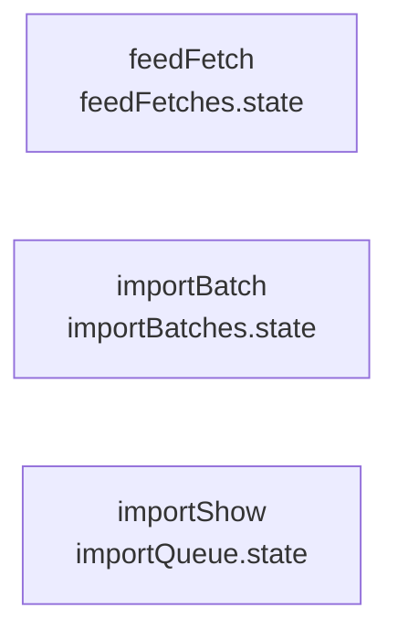
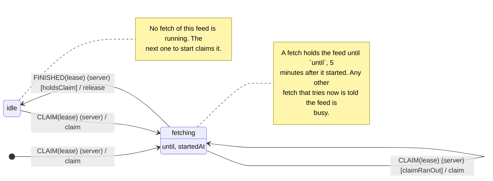
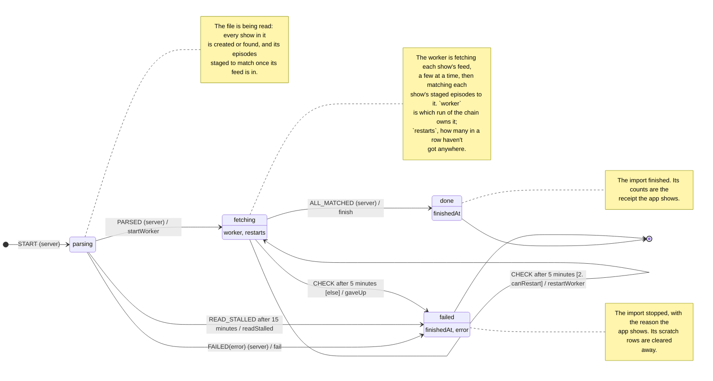
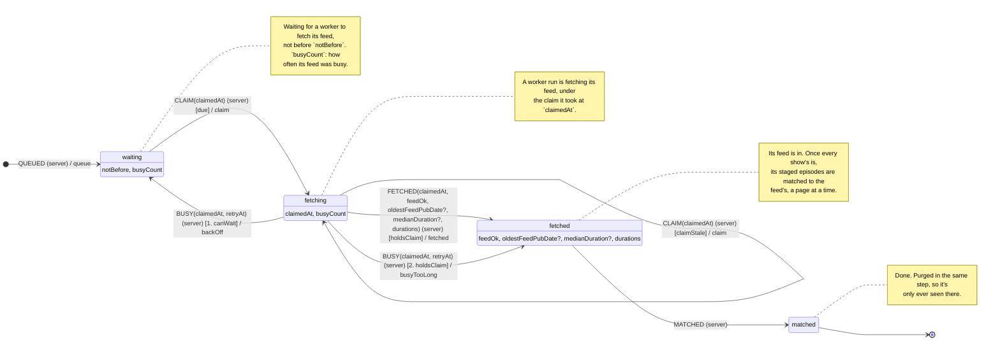

# State machines

Generated from each machine's rules by `npm run machines:diagrams`, and checked by `npm test` (`tests/stateMachines.test.ts`). Don't edit it by hand. The live version, with real rows in each state, is the website's admin Machines page (`/admin/machines`, Chef's admin only).

The rules live in `convex/lifecycles/`, and every machine is in the catalog in `convex/machines.ts`. Under each state are its own data fields. `[*] -->` is how a row is born and `--> [*]` marks a final state. Each event says who sends it: `(server)` for internal code, or its timer. The notes and the list under each diagram are the rules' own descriptions.

## Every machine

## `feedFetch`, on `feedFetches.state`

Whether a show's feed is being fetched right now, so one feed is never fetched twice at once, and only the fetch holding the claim records how it went.

How a row is born:

- `CLAIM(lease) (server)` → `fetching`. The first fetch of a feed (a new show, or one that was never fetched since claims moved here) claims it.

From `idle`:

- `CLAIM(lease) (server)` → `fetching`. A fetch starts: the poller's, a refresh, someone opening the show, or an import.

From `fetching`:

- `CLAIM(lease) (server)` [claimRanOut] stays put. The fetch holding it died or ran past its 5 minutes, so a new fetch takes the feed over. The old one's report will be refused.
- `FINISHED(lease) (server)` [holdsClaim] → `idle`. The fetch holding the claim has stored what it found (or its error), and lets the feed go.

## `importBatch`, on `importBatches.state`

One Overcast import, from reading the file to Up Next being seeded. It restarts itself when its worker stops, and ends once, as done or failed.

How a row is born:

- `START (server)` → `parsing`. Someone uploads their Overcast export in the app (or a script does), and reading it starts.

From `parsing`:

- The clock sends `READ_STALLED` after 15 minutes. 15 minutes since reading began, longer than Convex lets the reading action run: it died.
- `PARSED (server)` → `fetching`. Every show is staged: the first run of the worker starts fetching their feeds.
- `FAILED(error) (server)` → `failed`. The file couldn't be read (not an OPML file, or the upload's gone).
- `READ_STALLED after 15 minutes` → `failed`. Reading stopped part way. The person is asked to import again.

From `fetching`:

- The clock sends `CHECK` after 5 minutes. Every 5 minutes while it's fetching: is it still getting somewhere?
- `CHECK after 5 minutes` [1. madeProgress] stays put. It got somewhere since the last check: carry on.
- `CHECK after 5 minutes` [2. canRestart] stays put. Nothing for 5 minutes, so its worker died: a new run starts where it stopped, and the old one stops at its next step.
- `CHECK after 5 minutes` [else] → `failed`. Three restarts in a row got nowhere. The person is asked to import again.
- `ALL_MATCHED (server)` → `done`. Every show is fetched and matched, and Up Next has been seeded in Overcast's order.

## `importShow`, on `importQueue.state`

One show in an Overcast import: its feed fetched, then the history staged for it matched to its episodes. It stays queued until that's done, so a worker that dies loses no shows.

How a row is born:

- `QUEUED (server)` → `waiting`. Reading the export staged this show's episodes (or found them left without a row): it waits for a worker.

From `waiting`:

- `CLAIM(claimedAt) (server)` [due] → `fetching`. A worker run takes it and fetches its feed.

From `fetching`:

- `CLAIM(claimedAt) (server)` [claimStale] stays put. The run that claimed it 3 minutes ago never reported (it died): a newer run takes it over.
- `FETCHED(claimedAt, feedOk, oldestFeedPubDate?, medianDuration?, durations) (server)` [holdsClaim] → `fetched`. Its feed is in (or failed for good): what matching needs is noted, and it waits its turn to match.
- `BUSY(claimedAt, retryAt) (server)` [1. canWait] → `waiting`. Something else is fetching the feed (the poller, someone adding the show), so its episodes may be half stored. It waits 30 seconds rather than match against them.
- `BUSY(claimedAt, retryAt) (server)` [2. holdsClaim] → `fetched`. The other fetch never finished: it's matched as a failed feed, its history kept as ghosts.

From `fetched`:

- `MATCHED (server)` → `matched`. Every staged episode has been applied. The row is purged straight after.
