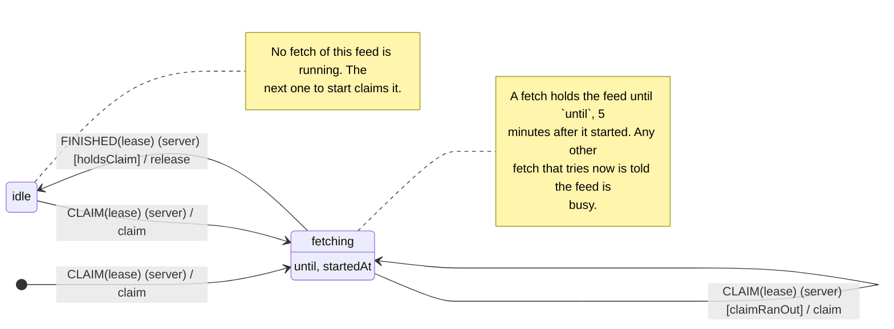

# State machines

Generated from each machine's rules by `npm run machines:diagrams`, and checked by `npm test` (`tests/stateMachines.test.ts`). Don't edit it by hand. The live version, with real rows in each state, is the website's admin Machines page (`/admin/machines`, Chef's admin only).

The rules live in `convex/lifecycles/`, and every machine is in the catalog in `convex/machines.ts`. Under each state are its own data fields. `[*] -->` is how a row is born and `--> [*]` marks a final state. Each event says who sends it: `(server)` for internal code, or its timer. The notes and the list under each diagram are the rules' own descriptions.

## `feedFetch`, on `feedFetches.state`

Whether a show's feed is being fetched right now, so one feed is never fetched twice at once, and only the fetch holding the claim records how it went.

How a row is born:

- `CLAIM(lease) (server)` → `fetching`. The first fetch of a feed (a new show, or one that was never fetched since claims moved here) claims it.

From `idle`:

- `CLAIM(lease) (server)` → `fetching`. A fetch starts: the poller's, a refresh, someone opening the show, or an import.

From `fetching`:

- `CLAIM(lease) (server)` [claimRanOut] stays put. The fetch holding it died or ran past its 5 minutes, so a new fetch takes the feed over. The old one's report will be refused.
- `FINISHED(lease) (server)` [holdsClaim] → `idle`. The fetch holding the claim has stored what it found (or its error), and lets the feed go.
